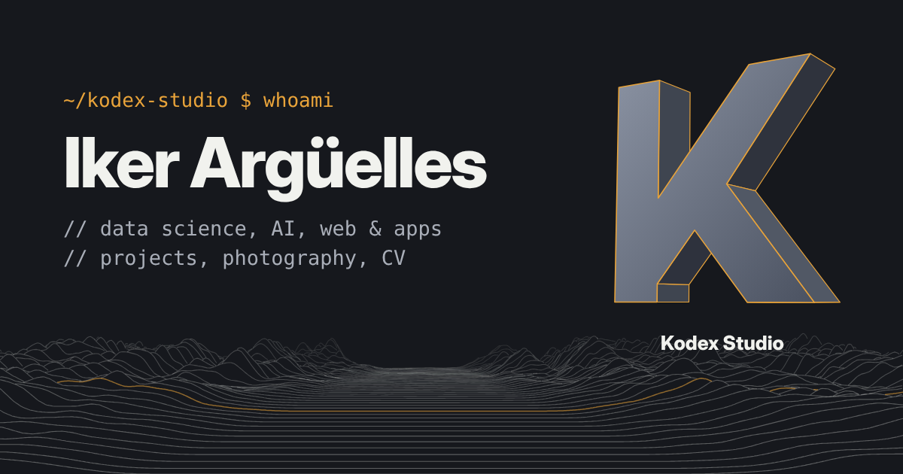

# Iker Argüelles · Kodex Studio

Personal site of Iker Argüelles: the projects he has built, his photography, his CV and
Kodex Studio, his freelance studio for code and camera.

**Live site:** https://ikeruuu.github.io/kodex_studio/



## What is on the page

| Section | What it shows |
|---|---|
| Hero | Name and role over a 3D ridgeline terrain, with the Kodex "K" extruded in 3D |
| About | A card that flips between a photo and a profile written as code |
| Things I've built | Project cards with filters (AI, data, web and apps, hardware, product) |
| Results | Timeline of competitions and academic results that fills in as you scroll |
| Behind the camera | A film strip of photos and clips; click a frame to open it full size |
| Kodex Studio | The services of the studio and how to ask for a quote |
| CV | A one-page CV that can be saved as PDF from the browser |
| Contact | Email, LinkedIn, GitHub and Instagram |

Everything is available in English and Spanish; the switch is in the top bar and the
choice is remembered on the device.

## How it is built

- Plain HTML, CSS and JavaScript. There is no build step and no framework.
- [three.js r128](https://threejs.org/) from cdnjs draws the terrain and the K. If WebGL
  or the library is not available, the page falls back to a flat background and
  everything else keeps working.
- Fonts come from Google Fonts: Bricolage Grotesque (headings), Instrument Sans (text)
  and JetBrains Mono (code).
- Motion is tied to scrolling and is switched off for visitors who ask their system to
  reduce motion.
- On phones the bar becomes a menu, the film strip scrolls sideways with the finger and
  the 3D K is placed inside the layout so it never covers the text.

## Files

```
index.html        Page markup and all the fixed texts (EN and ES)
css/site.css      Styles: colour and type tokens first, then one block per section
js/data.js        Content that changes often: projects, filters, photos, moving rows
js/site.js        Behaviour: language, project grid, film strip, viewer, menu, scroll
js/scene.js       The 3D background
assets/           Logo, portrait, link-preview image
assets/photos/    Photos and clips of the film strip
docs/GUIA.md      Step-by-step guide to edit and publish the site (in Spanish)
```

## Run it locally

Any static server works. With Python:

```bash
python -m http.server 8000
# then open http://localhost:8000
```

Opening `index.html` directly also works, but clips and the 3D scene behave better
through a server.

## Change the content

Most edits happen in `js/data.js`:

- **Add a project:** add an object to `PROJECTS` with `id`, `cat`, `title`, `ev`, `d`,
  `more`, `tags` and `links`. Texts take an `en` and an `es` version.
- **Add a photo or clip:** put the file in `assets/photos/` and add an entry to `PHOTOS`
  with its path, proportions (`w`, `h`), category, optional place and a description.
- **CV and fixed texts:** edit `index.html`. Each text appears twice, once inside
  `class="en"` and once inside `class="es"`.

`docs/GUIA.md` walks through each case with examples.

## Publish

The site is served by GitHub Pages from the `main` branch, root folder. Every push to
`main` updates the live site after a minute or two.

To turn Pages on in a fresh copy of the repository: **Settings → Pages → Build and
deployment → Source: Deploy from a branch → Branch: `main`, folder `/ (root)` → Save**.

To use your own domain, add it under **Settings → Pages → Custom domain** and create the
DNS record GitHub asks for. Then update the three absolute addresses at the top of
`index.html` (`canonical`, `og:url`, `og:image`).

## Rights

© Iker Argüelles. The photographs, clips, texts and the Kodex Studio logo are not
licensed for reuse. Ask first: arguellesiker@gmail.com
